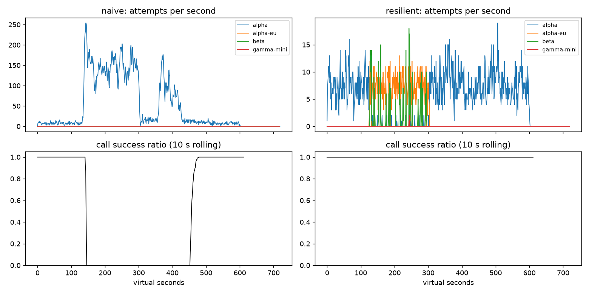

# Lab 25B — Report

**Họ tên / nhóm:** Bùi Phương Duy · **MSV:** 2A202602684

**Commit:** `fa3b2a0ab3968192895ca34ee0cb09c32e4ab041`

Hash trên xác định snapshot chứa toàn bộ code, cấu hình, report và số liệu bài nộp.
Commit kế tiếp chỉ ghi hash này vào report, không đổi code hoặc kết quả chấm.

**Điểm tự động (`make grade`):** 84 / 88

Scoreboard lần chấm cuối chạy với seed 25; các lần kiểm tra trước còn xác nhận PASS trên seed 26 và 27.
4 điểm SLO ẩn do giảng viên chấm.

Nguồn số liệu: `reports/gameday/*.json`, `reports/workflows.json`, `reports/slo.json` và `reports/cache/*.json`.

## 1. Kết quả Game Day (naive vs của bạn)

Seed 25; cấu hình cuối trong `configs/gameday.yaml`. Số liệu gốc: `reports/gameday/naive.json` và `resilient.json`.

| Băng | Client | availability | p95 (s) | amplification | retry_ratio | cost/turn | recovery (s) | PASS? |
|---|---|---:|---:|---:|---:|---:|---:|:---:|
| G1 | naive | 0.7194 | 7.157 | 7.738 | 6.738 | 2.163 | 4.0 | FAIL |
| G1 | resilient | 1.0 | 4.726 | 1.06 | 0.004 | 2.091 | 0.0 | PASS |
| G2 | naive | 0.456 | 15.034 | 9.904 | 8.904 | 4.627 | 155.0 | FAIL |
| G2 | resilient | 1.0 | 4.943 | 1.024 | 0.005 | 2.084 | 0.0 | PASS |
| G3 | naive | 1.0 | 4.768 | 1.164 | 0.164 | 2.328 | 0.0 | FAIL |
| G3 | resilient | 1.0 | 4.642 | 1.035 | 0.019 | 2.101 | 0.0 | PASS |
| G4 | naive | 1.0 | 13.764 | 1.004 | 0.004 | 2.008 | 0.0 | FAIL |
| G4 | resilient | 0.9995 | 5.419 | 1.036 | 0.007 | 2.124 | 0.0 | PASS |
| G5 | naive | 0.3699 | 5.359 | 17.03 | 16.03 | 2.124 | N/A | FAIL |
| G5 | resilient | 0.8179 | 5.484 | 1.008 | 0.007 | 2.518 | N/A | PASS |
| G6 | naive | 0.517 | 4.836 | 12.344 | 11.344 | 2.009 | 0.0 | FAIL |
| G6 | resilient | 1.0 | 5.957 | 1.058 | 0.019 | 2.225 | 0.0 | PASS |

Kiểm tra thêm seed 26 và 27: cả hai đều PASS 6/6 băng. Kết quả lưu tại `reports/gameday/seed26/` và `seed27/`. Chưa có băng ẩn của giảng viên.

## 2. Cấu hình client và lý do

| Tham số | Giá trị | Lý do và bằng chứng |
|---|---:|---|
| attempt_timeout_s | 4.0 | Dành thời gian cho fallback trước deadline 30 s. G6 availability 1.0, p95 5.957 s trên seed 25. |
| max_attempts_per_provider | 2 | Tối đa một retry cùng provider mỗi lần định tuyến, có budget và breaker kiểm soát. G2 amplification 1.024. |
| min_time_left_s | 1.0 | Không gửi attempt có timeout dưới 1 s; timeout được cắt theo deadline chung của lượt. Test deadline PASS. |
| backoff_base_s / cap_s | 0.25 / 4.0 | Full jitter tránh retry đồng thời; retry đầu có delay 0–0.25 s. G3 retry_ratio 0.019. |
| retry_budget_ratio / min_per_s / max_tokens | 0.1 / 0.5 / 20 | Bucket chung giới hạn retry khi nhiều call cùng lỗi; đây không phải trần 10% tuyệt đối vì có token ban đầu và hồi theo thời gian. G3 seed 25–27 retry_ratio 0.015–0.032. |
| quota_cooldown_s | 300 | Hết quota không retry cùng provider; cooldown được chia sẻ giữa các call. G5 availability 0.8179, client_error_retries 0. |
| breaker.window_size / min_calls | 20 / 10 | Giữ kết quả gần nhất, tránh trip do vài lỗi lẻ. G2 recovery 0 s và amplification 1.024. |
| breaker.failure_rate_threshold | 0.5 | Mở khi ít nhất nửa cửa sổ là lỗi sức khỏe provider; 400 và 429 không tính vào breaker. G5 unneeded_failovers 0. |
| breaker.slow_call_s / slow_rate_threshold | 3.0 / 0.6 | Phát hiện thành công nhưng chậm và mở khi ít nhất 60% cửa sổ chậm. G4 p95 5.419 s, dưới giới hạn 10 s. |
| breaker.open_duration_s | 10.0 | Thử phục hồi sau khoảng nghỉ ngắn; G2 recovery 0 s, primary_share_after_restore 1.0. |
| breaker.half_open_max_probes / half_open_successes | 2 / 2 | Tối đa hai probe đang bay; cần hai thành công nhanh để đóng. Test giới hạn probe và stale generation PASS. |

So sánh cấu hình ban đầu (timeout 8 s, slow threshold 5 s) với cấu hình cuối (4 s, 3 s), giữ nguyên các tham số khác:

| Băng | p95 trước → sau (s) | amplification trước → sau | availability trước → sau |
|---|---|---|---|
| G2 | 10.362 → 4.943 | 1.037 → 1.024 | 1.0 → 1.0 |
| G4 | 5.626 → 5.419 | 1.014 → 1.036 | 1.0 → 0.9995 |
| G6 | 5.961 → 5.957 | 1.055 → 1.058 | 1.0 → 1.0 |

Hai tham số được đổi cùng lúc, nên so sánh này chỉ đánh giá tác động kết hợp. G2 p95 giảm rõ rệt; G4 amplification tăng và availability giảm nhẹ, nhưng cả 6 băng vẫn đạt mọi check trên 3 seed. recovery 0 s là metric tính từ cửa sổ 30 s sau restore đạt ít nhất 95% call thành công; không có nghĩa mọi call đều hồi phục tức thì.

| Loại lỗi | Breaker | Quyết định |
|---|---|---|
| CLIENT_ERROR | release | GiveUp ngay; không retry, không failover. |
| QUOTA_EXHAUSTED | release | Cooldown dài, failover ngay. Không chờ cooldown quota. |
| RATE_LIMITED | release | Cooldown ít nhất retry-after, failover ngay. Chỉ chờ cooldown rate limit ≤ 5 s nếu không còn provider và vẫn đủ deadline. |
| OVERLOADED / SERVER_ERROR / TIMEOUT | on_failure | Retry cùng provider nếu còn lượt, budget, deadline và breaker cho phép; nếu không thì failover. |

Fallback theo thứ tự alpha → alpha-eu → beta → gamma-mini; tool call loại gamma-mini. Cooldown và breaker dùng chung giữa các call; chỉ ResilientClient điều khiển retry.

## 3. Ba thí nghiệm

Seed mô phỏng 25, seed backoff 1 như factory; cấu hình và kết quả đầy đủ lưu trong
`reports/gameday/experiments.json`. Mỗi biến thể tạo client mới, giữ nguyên các file simulator và băng sự cố;
cấu hình chính được giữ nguyên để chấm bài.
Chạy lại bằng `python scripts/run_report_experiments.py` từ thư mục repo.

**Thí nghiệm 1: bật/tắt retry budget khi breaker cấu hình sai.** Cả hai biến thể đặt
`breaker.min_calls: 1000000000`, `max_attempts_per_provider: 5`; budget bật dùng 0.1 / 0.5 / 20,
budget tắt dùng ratio 100, min_per_s 1.0e6, max_tokens 1.0e9.

| Băng | Budget | availability | amplification | retry_ratio | recovery (s) | p95 (s) |
|---|---|---:|---:|---:|---:|---:|
| G2 | bật | 0.9996 | 1.424 | 0.062 | 0 | 11.911 |
| G2 | tắt | 0.9801 | 1.870 | 0.544 | 0 | 19.504 |
| G3 | bật | 1.0 | 1.136 | 0.068 | 0 | 4.568 |
| G3 | tắt | 1.0 | 1.163 | 0.160 | 0 | 4.809 |

Budget giảm retry cùng provider ở G2 từ 0.544 xuống 0.062 và amplification từ 1.870 xuống 1.424;
khi tắt budget, có 47 call GiveUp vì deadline so với 1 vì no_provider_available lúc bật.
G3 vẫn đạt availability 1.0 ở cả hai cấu hình, nhưng retry_ratio 0.160 khi tắt vượt giới hạn 0.10.
Recovery đều 0 theo cửa sổ 30 s của grader: timeout ngắn, jitter, cooldown và fallback còn hoạt động,
nên thí nghiệm này không tái tạo toàn bộ cách hỏng của naive.
Với breaker đúng, G2 đạt amplification 1.024, retry_ratio 0.005; budget vẫn bảo vệ giai đoạn trước khi
đủ mẫu mở breaker và trường hợp breaker cấu hình sai, còn breaker tránh gửi first attempt vào provider hỏng.

**Thí nghiệm 2: timeout 30 giây, G6 và đối chứng G4.** Chỉ đổi `attempt_timeout_s` từ 4 lên 30.

| Băng | Timeout (s) | availability | give_up_reasons | p95 của lượt thành công (s) |
|---|---:|---:|---|---:|
| G6 | 4 | 1.0 | {} | 5.957 |
| G6 | 30 | 0.9488 | deadline: 107; no_provider_available: 15 | 5.440 |
| G4 | 4 | 0.9995 | no_provider_available: 1 | 5.419 |
| G4 | 30 | 1.0 | {} | 5.608 |

G6 giảm availability 5.12 điểm phần trăm và FAIL ngưỡng 95%: alpha-eu treo giữ attempt đến gần hết
deadline chung, khiến nhiều call không còn thời gian sang beta.
p95 giảm từ 5.957 xuống 5.440 s vì chỉ tính các lượt thành công; những lượt treo rồi thất bại bị loại khỏi
phân phối, nên đây là survivorship bias, không phải cải thiện độ trễ.
G4 vẫn trả lời hữu hạn và breaker nhận cả kết quả chậm, nên p95 gần nhau (5.419/5.608 s), availability
chỉ khác một lượt thất bại.
Timeout cần xét p99 bình thường của từng deployment, deadline cả lượt 30 s và thời gian dự phòng cho
fallback cùng call chat phía sau; 4 s được kiểm chứng trên các băng hiện tại, không phải giá trị dùng chung cho mọi hệ thống.

**Thí nghiệm 3: bỏ lọc khả năng tool.** Dùng subclass trong thí nghiệm trả nguyên fallback order từ `ladder()`;
không thay mã client chính.

| G6 | availability | incompatible_routes | give_up_reasons | p95 (s) |
|---|---:|---:|---|---:|
| Có lọc tool | 1.0 | 0 | {} | 5.957 |
| Không lọc tool | 0.8872 | 269 | incompatible_model_output: 269 | 5.650 |

269 tool call được model không hỗ trợ tool trả lời thành công ở tầng provider nhưng lượt user thất bại,
khiến availability giảm từ 100% xuống 88.72%.
Với người quản lý sản phẩm, đây là 269 lượt yêu cầu không hoàn thành đúng luồng hoàn tiền dù model có trả lời;
đáp án chat nhanh và rẻ không thay thế được quyết định gọi tool hợp lệ.
Lọc khả năng trước khi gửi giúp giữ `incompatible_routes = 0` và tránh tính phản hồi không tương thích là thành công.

## 4. Workflow hoàn tiền

| Executor | completion | crashes | duplicate refunds | duplicate emails | lost refunds | overpaid | wasted LLM / crash |
|---|---:|---:|---:|---:|---:|---:|---:|
| naive | 1.0 | 81 | 128 | 81 | 0 | 1496700 | 1.123 |
| yours | 1.0 | 66 | 0 | 0 | 0 | 0 | 0.303 |

Số liệu từ `reports/workflows.json`: 500 session, seed 25, chạy bằng
`python scripts/run_workflows.py --executor both`. Executor mới PASS mọi check:
500/500 hoàn tất, đúng 500 lần thực thi payment, 0 hoàn tiền/email trùng, 0 hoàn tiền mất,
0 overpaid và wasted LLM/crash 0.303 ≤ 0.6. Có 2.500 checkpoint được ghi (5 bước × 500 session).
Test còn kiểm tra 500 session với seed 11, crash sau payment, response bị mất và resume.

Idempotency key ổn định theo (session, step), mã hóa JSON để tránh nhập nhằng khi ghép chuỗi;
key side effect và checkpoint có namespace riêng. Retry chỉ bắt `ServiceError` và `ServiceTimeout`,
tối đa 5 attempt; `WorkerCrash` truyền lên runner để worker mới được khởi động.

Chỉ idempotency key chưa đủ: payment/email tránh chạy trùng, nhưng worker mới vẫn phải tính lại các bước
LLM và đọc order đã xong nếu không có checkpoint. Chỉ checkpoint chưa đủ: payment có thể đã thực thi
rồi worker chết trước khi ghi checkpoint, nên lần resume vẫn gọi payment lại. Dùng cùng idempotency key
trong khoảng trống này giúp provider trả lại kết quả đã lưu mà không chuyển tiền lần nữa.

Checkpoint được ghi sau khi step trả kết quả thành công. Ghi trước khi gọi payment có thể đánh dấu bước
đã xong dù chưa chuyển tiền; nếu worker chết giữa hai thao tác, resume bỏ qua payment và làm mất hoàn tiền.
Exactly-once ở đây là hiệu ứng payment/email trong mô phỏng, dựa trên dịch vụ hỗ trợ idempotency và store
sống qua crash; không phải bảo đảm mọi LLM computation chỉ chạy một lần (vẫn có 20 call LLM bị lãng phí).

## 5. Alerting & error budget

| Sự cố | Mong đợi | Naive alerter | Burn-rate alerter | Độ trễ phát hiện |
|---|---|---|---|---:|
| checkout_bug | page | page (1 phút) | page | 27 phút ≤ 35 |
| provider_outage | page | page (0 phút) | page | 4 phút ≤ 8 |
| deploy_blip | none | false page | không page | N/A |
| slow_leak | ticket | bỏ sót ticket | ticket, không page | 1337 phút ≤ 1800 |
| degraded_evening | page | page (214 phút) | page | 291 phút ≤ 330 |
| night_spike | none | false page | không page | N/A |
| small_bump | none | false page | không page | N/A |

Số liệu từ `reports/slo.json`, chạy bằng `python scripts/run_slo.py --alerter both`:
burn-rate alerter PASS, có 3 page, 1 ticket, 0 false page; naive có 7 page, 0 ticket, 3 false page.
Mỗi rule cần cả cửa sổ dài và ngắn cùng vượt ngưỡng: page 14.4× (60/5 phút), page 6× (360/30 phút),
ticket 1× (4320/360 phút). Burn rate tính theo tổng bad/tổng total trong cửa sổ, không lấy trung bình
tỷ lệ từng phút. Prefix sum dựng O(n), mỗi truy vấn cửa sổ O(1); episode kết thúc tại phút đầu tiên
rule ngừng firing và được lưu với end exclusive.

Error budget 30 ngày: 25.901.755 request, 55.618 lỗi; được phép khoảng 129.508,8 lỗi tại SLO 99,5%.
Availability đo được 99,7853%; budget đã tiêu **42,95%**, còn **57,05%**.
`freeze_releases = false`: chưa hết error budget nên không đóng băng release theo quy tắc của lab.
Tính tỷ lệ và quyết định freeze từ số chưa làm tròn; chỉ làm tròn khi xuất report.

`small_bump` có 12% lỗi trong 20 phút, nhưng cửa sổ dài giúp phân biệt một đợt ngắn với sự cố
đang tiêu budget nhanh trên quy mô lớn. Khi traffic gần đều, 12% × 20/60 ≈ 4% lỗi trong 1 giờ,
thấp hơn ngưỡng fast page 14.4 × 0.5% = 7.2%; cửa sổ 6 giờ cũng pha loãng đợt ngắn này.
Trên dữ liệu thực, burn rate dài tối đa quanh `small_bump` là 8.2254× (1 giờ) và 1.9105×
(6 giờ), đều thấp hơn ngưỡng page tương ứng 14.4× và 6×. Đợt này có 1.794 request lỗi,
tương đương khoảng 1.39% error budget tháng.
Vì phải vượt cả cửa sổ dài và ngắn, alerter không page; naive chỉ nhìn 5 phút nên đánh thức on-call.
Dữ liệu SLO ẩn của giảng viên chưa có, chưa khẳng định kết quả trên bộ đó.

## 6. Postmortem — Băng G2 với client naive (blameless)

Nguồn: `reports/gameday/naive.json`, `naive_G2_overload_storm_timeseries.csv` và hình bên dưới.

**Tóm tắt:** Alpha mất 75% năng lực xử lý từ giây 120 đến 300, kích hoạt hàng đợi dài và timeout.
Client naive với ba tầng retry tạo 34.475 attempt cho 3.481 logical call, khiến 1.285/2.362 lượt user thất bại.
Sau khi năng lực provider hồi phục, client cần thêm 155 giây để đạt tiêu chí recovery, trong khi client mới
đạt availability 100%, amplification 1.024 và recovery 0 s theo metric của grader.

**Ảnh hưởng:** 1.285 lượt thất bại, tương đương 54.40% của 2.362 lượt trong băng 600 s;
p95 của lượt thành công là 15.034 s, cost/good turn 4.627 so với 2.084 của resilient.
Từ trigger ở t=120 đến điểm recovery t=455 là 335 s; sự cố provider dài 180 s, phần kéo dài sau restore là 155 s.
Đây là khoảng từ trigger đến phục hồi theo metric, không có nghĩa mọi giây trong khoảng đó đều mất 100% dịch vụ.

Để quy đổi error budget tháng, giả sử SLI đếm lượt user, traffic duy trì trung bình 4 lượt/s suốt 30 ngày,
tháng chỉ có sự cố này và ngoài sự cố không có lượt thất bại.
Tổng tháng = 4 × 30 × 86.400 = 10.368.000 lượt; budget 0.5% = 51.840 lượt lỗi.
Sự cố tiêu 1.285/51.840 = **2.48% budget tháng**, còn 97.52%; **không vượt** toàn bộ budget tháng.
Nếu chỉ xét băng 600 s, mức lỗi 54.40% lớn hơn tỷ lệ cho phép 0.5% khoảng 108.8 lần;
không được coi tỷ lệ trên băng ngắn là tỷ lệ tiêu ngân sách cả tháng.

**Timeline:** mỗi hàng tổng hợp đúng cửa sổ [t, t + độ dài), từ CSV naive;
attempts/s là tổng attempt alpha chia độ dài, success ratio = calls_ok/calls_done (logical call, không phải lượt user).

| t (s) | Cửa sổ (s) | Sự kiện | Attempts/s | Call thành công / hoàn tất | Success ratio |
|---:|---|---|---:|---:|---:|
| 100 | [100,110) | Trước sự cố, tải bình thường | 7.2 | 68/68 | 100% |
| 120 | [120,130) | Alpha mất 75% năng lực; chưa thấy hết hậu quả ở call đã hoàn tất | 6.2 | 32/32 | 100% |
| 180 | [180,190) | Retry storm đã hình thành | 148.1 | 0/43 | 0% |
| 290 | [290,300) | Cuối sự cố provider, lượng retry vẫn cao | 146.1 | 0/41 | 0% |
| 300 | [300,310) | Provider hồi phục; client vẫn chưa phục hồi | 38.8 | 0/18 | 0% |
| 330 | [330,340) | Call tiếp tục thất bại sau restore | 14.9 | 0/32 | 0% |
| 400 | [400,410) | Tải retry lại tăng; chưa thoát vòng lặp | 77.9 | 0/40 | 0% |
| 455 | [455,485) | Cửa sổ đầu tiên sau restore đạt ≥ 95% success | 10.867 | 352/368 | 95.65% |
| 480 | [480,490) | Cửa sổ kiểm tra sau hồi phục | 10.6 | 124/124 | 100% |

**Trigger và root cause:** Trigger là giảm năng lực alpha còn 25% trong 180 s.
Root cause nằm ở cơ chế client: app × gateway × SDK cho phép tối đa 36 attempt/call,
delay cố định 0.2 s, không full jitter, không retry budget, không breaker và không fallback.
Timeout được coi như mọi lỗi khác và tiếp tục retry, dù request cũ vẫn nằm trong hàng đợi server.

Tại t=300, server còn xử lý các request mà client đã bỏ chờ; client tiếp tục gửi retry và tạo timeout mới.
Chuỗi hàng đợi dài → timeout → retry → thêm công việc server → hàng đợi dài tự duy trì sau khi trigger kết thúc.
Tải ở [180,190) đạt 148.1 attempt/s, hơn 20 lần mức 7.2 ở [100,110);
naive có 2.737 client_timeout, 3.194 overloaded_error và 26.298 rate_limit_exceeded trong toàn băng.
CSV không đo trực tiếp độ sâu hàng đợi; việc request timeout vẫn dùng tài nguyên được xác nhận bởi cơ chế
`sim/providers.py`, còn số liệu cho thấy hệ thống tiếp tục thất bại sau restore.

**Điều giúp và làm tệ hơn:** Provider khôi phục năng lực và deadline hạn chế tuổi lượt user,
nhưng retry cố định và bỏ qua retry-after tạo thêm 28.381 vi phạm retry-after trên G2.
Client mới giới hạn một tầng retry, phản ứng với lỗi sức khỏe và call chậm, tránh provider đang cooldown,
và chuyển sang deployment phù hợp; số liệu G2 giảm amplification 9.904 → 1.024, p95 15.034 → 4.943 s.
Baseline phản ánh thiếu lớp bảo vệ và thiếu kiểm thử tải sự cố trong thiết kế; postmortem không quy lỗi cho cá nhân.

**Action items đề xuất:** owner là vai trò chịu trách nhiệm, chưa phải cam kết đã triển khai trong production.

| # | Hành động | Loại (prevent / detect / mitigate) | Owner | Cách kiểm chứng |
|---|---|---|---|---|
| 1 | Duy trì retry ở một tầng, tắt retry chồng trong SDK/gateway; bật jitter và budget | prevent | Kỹ sư client | G2 amplification ≤ 1.2 với breaker đúng; G3 retry_ratio ≤ 0.10 trên 3 seed |
| 2 | Đưa băng quá tải và call chậm vào kiểm tra CI với cấu hình client thật | prevent | Chủ pipeline CI | G2 recovery ≤ 30 s, G4 p95 ≤ 10 s và primary share sau restore ≥ 0.8; thất bại thì chặn merge |
| 3 | Theo dõi attempt/logical call, lỗi provider, timeout và breaker transition cùng availability | detect | Kỹ sư SRE | Replay G2; dashboard hiển thị mức amplification 9.904 của naive, cảnh báo khi amplification > 1.6 kéo dài 30 s; test blip không false page |
| 4 | Dùng timeout 4 s, breaker sliding-window và fallback đã lọc tool để giảm tải primary | mitigate | On-call ShopAgent | G1 không vi phạm retry-after; G2 availability ≥ 95%; G6 availability ≥ 95% và incompatible_routes = 0 trên 3 seed |

## 7. Một điểm yếu còn lại

Khi mọi provider sập, cache chỉ bảo vệ câu FAQ chung đã có câu trả lời: C1 vẫn có availability tổng 0.9124,
tức còn 8.76% lượt thất bại, dù FAQ availability đạt 0.9645.
Câu cá nhân và luồng cần tool không có provider để hoàn thành; stale-if-error cũng không cung cấp dữ liệu
tài khoản mới hoặc thực thi hoàn tiền.
Hướng cải thiện là nhận yêu cầu bằng một ticket bền vững, báo trạng thái chờ rõ ràng và resume workflow
bằng checkpoint/idempotency khi dịch vụ hồi phục; cần sự đồng ý từ yêu cầu sản phẩm về xử lý bất đồng bộ.
Kiểm chứng ở băng tất cả provider sập: không mất ticket, không hoàn tiền trùng, mọi ticket được xử lý sau
restore; vẫn báo cáo riêng tỷ lệ hoàn tất trong deadline 30 s để tránh che giấu chất lượng dịch vụ.

## 8. Cache (Part G)

Số từ `reports/cache/resilient.json`, `cached.json` và `experiments.json`, seed 25.
Lệnh tương đương `make cache` trên Windows: `python scripts/run_gameday.py --scenarios configs/scenarios_cache.yaml --client resilient,cached --out reports/cache`.

| Client | availability | faq_availability | cache_hit_ratio | stale_served | wrong_answers | outdated_answers | cost/turn | PASS? |
|---|---:|---:|---:|---:|---:|---:|---:|:---:|
| resilient (không cache) | 0.8373 | 0.8424 | 0 | 0 | 0 | 0 | 1.386 | FAIL |
| cached (của bạn) | 0.9124 | 0.9645 | 0.652 | 157 | 0 | 3 | 0.915 | PASS |

Cấu hình starter (0.80 / 600 s / 0 s) có hit ratio 0.742 nhưng trả nhầm 181 câu
(`wrong_answers_by_reason: other_question`) và 80 câu lỗi thời; FAQ availability chỉ 0.8587.
Kết quả starter được giữ tại `reports/cache/starter/`.

Cấu hình cuối PASS mọi check C1 trên seed 25, 26, 27: FAQ availability lần lượt
0.9645 / 0.9563 / 0.9604; hit ratio 0.652 / 0.659 / 0.652; wrong_answers đều 0;
outdated_answers 3 / 2 / 3. Băng ẩn chưa được kiểm tra.

| Tham số `cache:` | Giá trị | Vì sao (số liệu nào) |
|---|---:|---|
| similarity_threshold | 0.90 | Loại near miss: 0 câu sai, so với 157 câu sai ở 0.80 khi giữ TTL và stale như cấu hình cuối. Hit ratio 0.652 cao hơn 0.581 ở 0.97. |
| ttl_s | 60 | Chỉ 3 câu lỗi thời, dưới giới hạn 15; TTL 300 s có 95 câu lỗi thời. TTL 30 s có 2 nhưng hit ratio giảm còn 0.592. |
| max_stale_s | 300 | Giữ câu cũ đủ lâu qua outage 120 s; FAQ availability 0.9645 so với 0.8733 khi tắt stale. Vẫn invalidate và tách prompt version trong cửa sổ stale. |
| max_entries | 500 | Giữ giới hạn starter và dùng LRU. Test eviction PASS; các băng hiện tại không chứng minh đây là dung lượng tối ưu. |

Thí nghiệm (mỗi cái 2–4 câu + số):

Mỗi thí nghiệm dưới đây chỉ thay một tham số so với cấu hình cuối.

| Thí nghiệm | FAQ availability | Hit ratio | Wrong | Outdated | Stale served | Cost/turn |
|---|---:|---:|---:|---:|---:|---:|
| threshold 0.80 | 0.8733 | 0.666 | 157 | 1 | 152 | 0.965 |
| threshold 0.90 (cuối) | 0.9645 | 0.652 | 0 | 3 | 157 | 0.915 |
| threshold 0.97 | 0.9640 | 0.581 | 0 | 4 | 153 | 0.964 |
| TTL 30 s | 0.9645 | 0.592 | 0 | 2 | 192 | 0.955 |
| TTL 300 s | 0.9640 | 0.731 | 0 | 95 | 68 | 0.863 |
| stale 0 s | 0.8733 | 0.561 | 0 | 3 | 0 | 0.975 |

1. **Ngưỡng.** 0.80 có 157 lỗi `other_question`: embedding gần nhau không đảm bảo cùng ý định.
   Catalog có các cặp dễ nhầm như chính sách hoàn tiền/thời gian nhận tiền hoàn và phí ship nội thành/ngoại tỉnh;
   số liệu tổng hợp không xác định số lỗi của từng cặp. 0.90 giữ 0 câu sai và hit ratio 0.652;
   tăng lên 0.97 vẫn an toàn trên băng này nhưng giảm hit ratio và tăng cost/turn lên 0.964.
2. **TTL.** TTL 30 / 60 / 300 s có outdated_answers 2 / 3 / 95 và hit ratio 0.592 / 0.652 / 0.731.
   Thay đổi phí ship không phát webhook nên invalidation không được gọi; TTL giới hạn thời gian dùng câu trả lời
   cũ khi provider khỏe. Nếu provider đang lỗi thì stale-if-error còn có thể kéo dài đến TTL + max_stale_s;
   TTL không phải giới hạn tuyệt đối cho tuổi câu trả lời trong outage.
3. **Stale-if-error.** Tắt stale làm FAQ availability giảm từ 0.9645 xuống 0.8733,
   giảm 9.12 điểm phần trăm, stale_served từ 157 xuống 0. Câu cá nhân và các câu chưa được cache
   vẫn cần provider nên cache không đưa availability lên 100%.

Trả lời:

- Câu hỏi cá nhân phụ thuộc dữ liệu thay đổi liên tục: trạng thái đơn, tiền hoàn, điểm tài khoản.
  Cache theo user chỉ ngăn chia sẻ chéo, không đảm bảo thông tin còn đúng hoặc quyền truy cập còn hiệu lực.
  Lab loại toàn bộ `request.personal` khỏi cả store và lookup, kể cả phục vụ stale.
- Theo dõi đồng thời availability phía user và sức khỏe provider: tỷ lệ lỗi/timeout trên attempt thực sự gọi
  provider, trạng thái breaker và tỷ lệ phục vụ stale. Với C1, stale_served = 157 dù FAQ availability = 0.9645;
  nên dashboard chỉ nhìn thành công phía user sẽ che mất outage. Provider failure/timeout và breaker OPEN
  kéo dài cần cảnh báo độc lập; cảnh báo ticket khi tỷ lệ stale hoặc tuổi câu trả lời tăng kéo dài.
